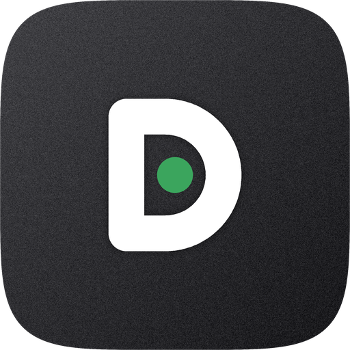

# DPM

DPM (Discord Presence Manager) puts what you're doing on your Android phone into your Discord status. The music you're playing, the video you're watching, the game or app you have open.

> [!WARNING]
> Discord doesn't allow presence from a user account, so the account can get limited or banned. If you can, use an alternate one. DPM isn't affiliated with Discord.

## What you get

- It follows along. Whatever's playing comes first, then the game or app on your screen.
- A static mode, where you write the status yourself.
- A live preview that looks like the card Discord shows.
- Per-app control: allow an app, ignore it, or give it its own text.
- A schedule by day and hour, plus an option to only share while you're online.
- Several accounts. Log in with the browser, a token or a QR code and switch instantly.
- App icons and cover art, through a Discord application of your own.
- A notification with Pause and Stop, so you can control it from anywhere.
- Updates from GitHub that you can install without leaving the app.
- A Material 3 Expressive interface that follows your wallpaper colors.

You need Android 10 or newer. Wallpaper colors need Android 12 and the themed icon needs Android 13.

## Getting it

Download the APK from the [latest release](https://github.com/DinoCDX/discord-presence-manager/releases/latest) and install it.

## First run

1. Log in. The Browser option is the easiest, since captchas, 2FA and passkeys all work there.
2. Click through the intro and allow what you're happy with. Every permission can be skipped.
3. On the Presence tab, switch on Share my presence.
4. On the Apps tab, choose which apps are allowed to show up.
5. For images, make an application in the [Discord developer portal](https://discord.com/developers/applications) and paste its Application ID into Settings.

The [docs](docs/index.html) go into more detail.

## Permissions

| Permission | What it's for |
| --- | --- |
| Internet | Talking to Discord and GitHub |
| Notifications | Pause and Stop in the notification |
| Usage access | Seeing which app or game is on screen |
| Notification access | Reading what media is playing |
| Battery optimization | Keeping Android from putting the app to sleep |
| Start at boot | Bringing presence back after a restart |
| Installed apps | The app list and icons |
| Install packages | Installing downloaded updates |

Your token is kept in encrypted preferences on the phone and is only ever sent to Discord.

## Credits

Made by [DinoCDX](https://github.com/DinoCDX). Built with Kotlin, Jetpack Compose, Material 3 Expressive, OkHttp and ZXing.
